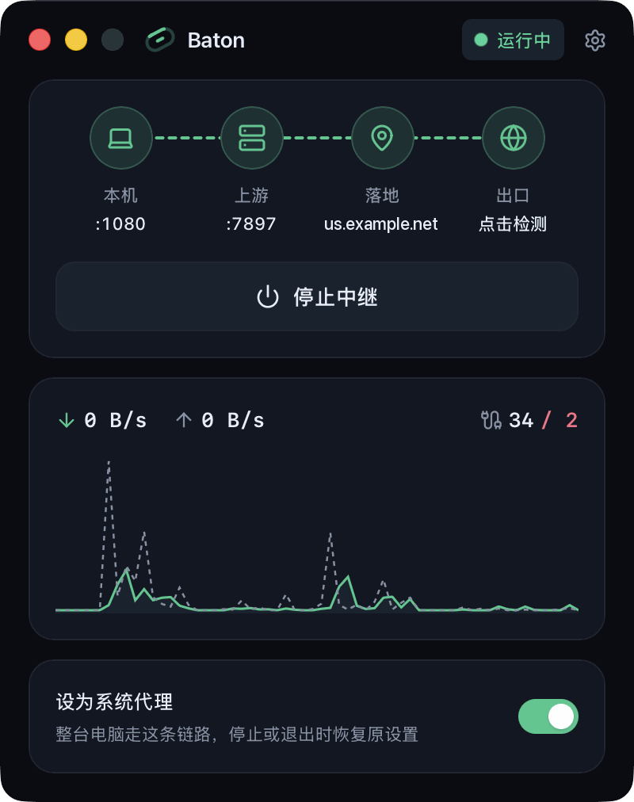

# Baton

Baton is a desktop proxy relay for macOS and Windows. It chains an existing local proxy with a remote landing proxy and serves the combined route through a single local endpoint.

<p align="center">
  
</p>

```
Application ──► Baton (127.0.0.1:1080) ──► Upstream proxy ──► Landing proxy ──► Destination
```

## Features

- Accepts HTTP and SOCKS5 connections on a single local port.
- Chains two hops over HTTP CONNECT or SOCKS5, with optional authentication on each hop.
- Uses a fixed upstream address or the operating system's current proxy setting as the first hop.
- Bypasses the chain for local, LAN, and user-specified addresses.
- Optionally acts as the system proxy and restores the original settings when the relay stops.
- Reports the egress IP address and live traffic statistics.

## Getting Started

1. Set the upstream to the address of an existing local proxy, or select **System proxy**.
2. Set the landing proxy.
3. Select **Start Relay** and configure applications to use `127.0.0.1:1080`.

## Building from Source

Building requires Rust, Node.js 22 or later, and the [Tauri prerequisites](https://tauri.app/start/prerequisites/) for your platform.

```sh
npm install
npm run tauri build -- --no-bundle
```

Use `npm run tauri dev` to run the app in development mode.

## Releasing

### Setup

1. Generate the updater signing key, then put the contents of `~/.tauri/baton.key.pub` into `plugins.updater.pubkey` in [`src-tauri/tauri.conf.json`](src-tauri/tauri.conf.json):

   ```sh
   npx tauri signer generate -w ~/.tauri/baton.key
   ```

2. Add these secrets under **Settings** → **Secrets and variables** → **Actions**:

   | Secret                               | Value                                                                    |
   | ------------------------------------ | ------------------------------------------------------------------------ |
   | `TAURI_SIGNING_PRIVATE_KEY`          | Contents of `~/.tauri/baton.key`                                         |
   | `TAURI_SIGNING_PRIVATE_KEY_PASSWORD` | Key password, if any                                                     |
   | `APPLE_CERTIFICATE`                  | Developer ID Application `.p12`, Base64-encoded                          |
   | `APPLE_CERTIFICATE_PASSWORD`         | `.p12` export password                                                   |
   | `APPLE_SIGNING_IDENTITY`             | Output of `security find-identity -v -p codesigning`                     |
   | `APPLE_ID`                           | Apple ID email                                                           |
   | `APPLE_PASSWORD`                     | App-specific password from appleid.apple.com                             |
   | `APPLE_TEAM_ID`                      | Apple Developer Team ID                                                  |

### Publishing

```sh
npm run release -- 0.2.0
```

This bumps the version, tags `v0.2.0`, and pushes. GitHub Actions then builds and signs both platforms into a draft release. Publish the draft, and installed copies will offer the update.

## License

Baton is released under the [MIT License](LICENSE).
